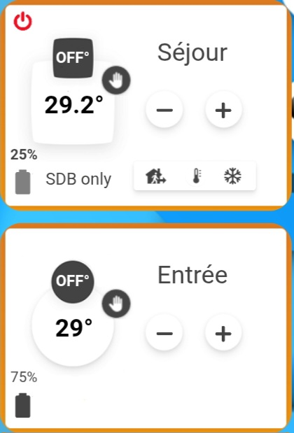

# 🌡️ JP Netatmo Cards Premium



Une suite de cartes Lovelace "Tout-en-un" haut de gamme pour les thermostats et vannes Netatmo. Cette suite remplace les configurations `picture-elements` complexes par une solution élégante, réactive et facile à configurer.

## ✨ Caractéristiques

- **🎨 Design Fidèle** : Reprend l'esthétique premium de Netatmo avec une intégration parfaite.
- **🔥 Témoin de Chauffe Dynamique** : La flamme de chauffe apparaît uniquement lorsque le chauffage est actif.
- **🔄 Modes Intelligents Interactifs** : Changement d'icône en temps réel. Un clic sur l'icône centrale permet d'annuler une dérogation et de repasser au **Planning**.
- **🕹️ Contrôle Intégré** : 
    - Ajustement de la température (+/- 0.5°C) via les flèches.
    - Switch On/Off rapide (Masquable).
    - Sélecteur de mode (Absent, Auto, Hors-gel) en un clic (Masquable).
- **🔋 Monitoring** : Affichage du pourcentage de batterie avec icône interactive (More-info).
- **📅 Planning Interactif** : Visualisation du planning actif et possibilité de le changer en cliquant sur son nom (Masquable).
- **📏 Taille Flexible** : Support du paramètre `max_width` pour réduire les dimensions de la carte tout en gardant ses proportions.

## 🚀 Installation

### Via HACS
1. Dans HACS, ajoutez ce dépôt comme **Dépôt personnalisé**.
2. Recherchez "JP Netatmo Card" et cliquez sur installer.

## 🛠️ Guide des Paramètres

| Paramètre | Type | Défaut | Description |
| :--- | :--- | :--- | :--- |
| `type` | string | **Requis** | `custom:jp-netatmo-card` |
| `entity` | string | **Requis** | Entité `climate` de votre thermostat. |
| `room_name` | string | `Salon` | Nom de la pièce affiché sur la carte. |
| `images_path` | string | `/local/images/netatmo/` | Chemin vers le dossier contenant les icônes. |
| `max_width` | string | `100%` | Largeur maximale de la carte (ex: `250px`). |
| `show_toggle` | boolean | `true` | Affiche ou masque le bouton On/Off en haut à gauche. |
| `show_modes` | boolean | `true` | Affiche ou masque la barre de sélection des modes en bas. |
| `show_schedule` | boolean | `true` | Affiche ou masque le texte du planning en bas à gauche. |
| `hvac_action_sensor` | string | `sensor.netatmo_hvac_action` | Capteur d'état de chauffe. |
| `preset_mode_sensor` | string | `sensor.netatmo_preset_mode` | Capteur du mode actuel. |
| `target_temp_sensor` | string | `sensor.netatmo_temperature_consigne` | Capteur de la température cible. |
| `battery_sensor` | string | `sensor.thermostat_salon_battery_percent` | Capteur de batterie. |
| `schedule_select` | string | `select.home` | Sélecteur du planning. |

## 📦 Dépendances (Scripts)

La carte est conçue pour fonctionner avec vos scripts existants :
- `script.netatmo_adjust_temp` : Pour monter/descendre la température.
- `script.netatmo_modes_unifie` : Pour changer les modes et le On/Off.

## 🚀 Exemple de configuration Minimaliste

```yaml
type: custom:jp-netatmo-card
entity: climate.chambre
room_name: "Chambre"
show_toggle: false    # Masque le On/Off
show_modes: false     # Masque la barre de modes du bas
show_schedule: false  # Masque le planning
max_width: "250px"
```

---
*Créé par JP - Version Premium HACS.*
